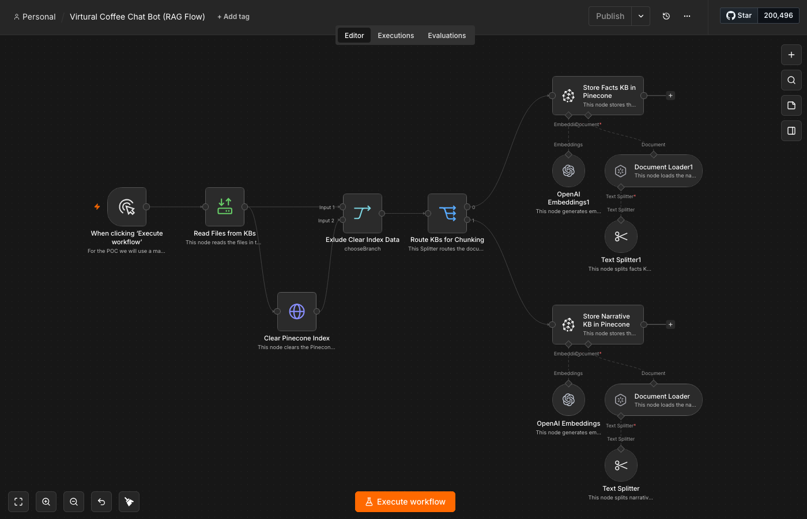
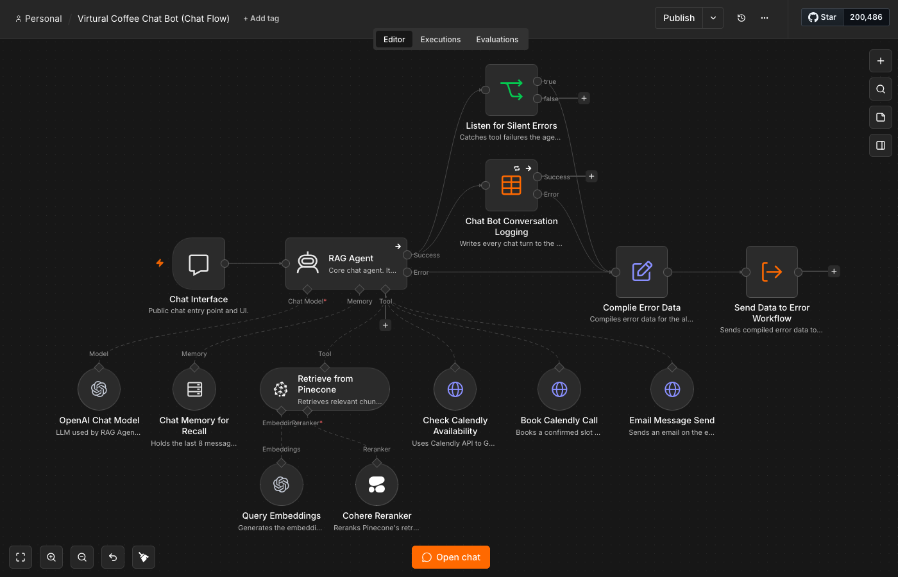
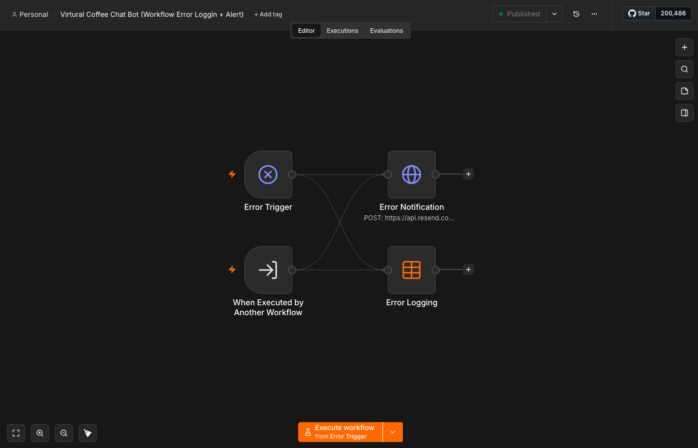

# Virtual Coffee Chat Bot
**Author:** John Adams

A RAG-backed conversational chatbot that stands in for a first coffee chat with me (John), so a recruiter or hiring manager can ask about his work history, skills, and projects, then book a call or send a message directly from the conversation.

This README covers setup, how to run it, the file map, and the architecture. See `project documentation/project_plan.md` for more project context, `project documentation/stack_decision.md` for why n8n/OpenAI/Pinecone/Cohere were chosen and `project documentation/workflow_diagram_v2.md` for the current build.

---

## What this is

Per the project brief's "autonomous research agent" framing, reinterpreted for a conversational use case:
- **The trigger** is each chat message, not a scheduled run.
- **The autonomous loop** is retrieve → generate → log → (optionally) act on a tool, all without human intervention between messages.
- **The structured report** is the `chat_log` Data Table — every turn logged with the question, answer, and thumbs up/down feedback.

---

## Architecture

Three n8n workflows:

1. **Ingestion (`Virtural Coffee Chat Bot (RAG Flow)`)** — reads the `kb/` markdown files, clears and rebuilds the Pinecone index, chunks and embeds facts and narrative content separately (different chunk sizes for each), tags each chunk with `source_type` metadata. Manual trigger, run whenever KB content changes.
2. **Chat Flow (`Virtural Coffee Chat Bot (Chat Flow)`)** — the live chat. A LangChain agent (`RAG Agent`) with five tools: knowledge base retrieval (Pinecone + Cohere rerank), Calendly availability check, Calendly booking, and email send. Every turn is logged to `chat_log`. Failures — whether the agent crashes outright, a tool call fails silently underneath it, or logging itself fails — are all caught and routed to the error-alert system without ever showing raw errors to the end user.
3. **Error Logging + Alert (`Virtural Coffee Chat Bot (Workflow Error Logging + Alert)`)** — centralized error handling. Two entry points (n8n's native Error Trigger for hard crashes, plus a manual entry point for errors caught locally) both feed the same two actions: log to `error_log` and email John.

### Ingestion (RAG Flow)



### Chat Flow



### Error Logging + Alert



Full node-by-node breakdown: `project documentation/workflow_diagram_v2.md`.

---

## Tools / APIs used

| Tool | Purpose |
|---|---|
| n8n (self-hosted, Docker) | Primary orchestration |
| OpenAI (`gpt-5-mini`, `text-embedding-3-small`) | Chat generation + embeddings |
| Pinecone | Vector store for the knowledge base |
| Cohere (`rerank-v3.5`) | Reranks retrieved chunks before they reach the agent |
| Calendly API | Availability check + booking |
| Resend API | Sends email on the end user's behalf |
| n8n Data Tables | `chat_log` (conversation log) and `error_log` (error alert log) |

---

## Setup

1. **n8n**, self-hosted via Docker. Compose file mounts this project folder into the container (`/data/project`) with `N8N_RESTRICT_FILE_ACCESS_TO` set to that path.
2. **Credentials** (set up in n8n's own credential store, never in these files): OpenAI, Pinecone, Cohere, Calendly (Personal Access Token with `users:read`, `event_types:read`, `scheduling_links:write`, `scheduled_events:read`, `scheduled_events:write` scopes), Resend (via HTTP Header Auth), and Basic Auth for the public chat widget.
3. **Pinecone index**: one index (`curious-john`), created with OpenAI's `text-embedding-3-small` model, dimension 512.
4. **Import the three workflow JSON files** from `workflows/` into n8n.
5. **Chat UI**: `chat-ui/index.html`, a static page using the `@n8n/chat` package via CDN, pointed at the Chat Flow workflow's webhook URL. Must be served over HTTP (not opened via `file://`, which breaks the widget) — e.g. `python3 -m http.server` from the `chat-ui/` folder, or the production Cloudflare tunnel setup.

## Environment variables / secrets

No secrets are committed to this repo. All credentials live in n8n's own credential store. The Docker compose file (not committed, see `.gitignore`) sets:
- `N8N_RESTRICT_FILE_ACCESS_TO=/data/project`

## Running it

1. Run the **Ingestion** workflow manually whenever `kb/` content changes. It clears the Pinecone namespace and rebuilds it from scratch (safe to re-run any time).
2. The **Chat Flow** workflow must be **published/active** for its public webhook to work — n8n only registers a webhook when the workflow is active, not just saved.
3. Open the chat UI (served over HTTP) and start a conversation.
4. Check `chat_log` in n8n's Data Tables for the conversation record; check `error_log` and email if something breaks.

---

## File map

```
.
├── README.md                      # this file
├── project documentation/
│   ├── project_plan.md            # industry/problem framing, stack, scope, risks
│   ├── stack_decision.md          # stack choice + justification
│   ├── workflow_diagram_v2.md     # built architecture
│   └── gtm_future_sprints_v2.md   # 3-future sprint GTM plan
├── kb/
│   ├── facts/                     # CV content, CliftonStrengths — structured, factual
│   └── narrative/                 # career story, identity, cover letter voice, recruiter Q&A
├── chat-ui/
│   └── index.html                 # custom chat widget (@n8n/chat)
├── workflows/                     # exported n8n workflow JSON (all three workflows)
├── assets/                        # workflow screenshots
└── samples/                       # sample conversation reports
```

---

## Known limitations

- No automated detection for a node reporting success with silently wrong output and no failure language involved — the error-alert system catches crashes and verbalized tool failures, not that broader category.
- Streaming chat responses mean a hard RAG Agent crash mid-turn can't be gracefully re-routed from n8n's side; the friendly fallback message for that case is applied client-side in `chat-ui/index.html` instead.
